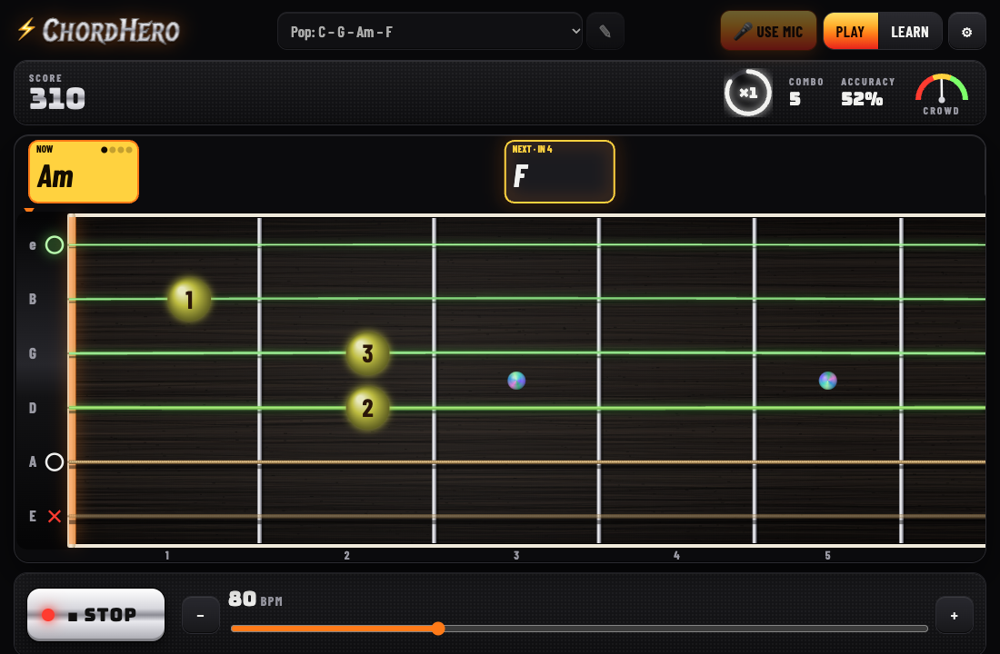
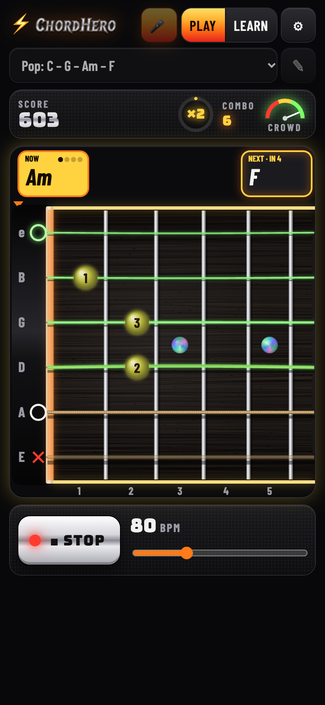
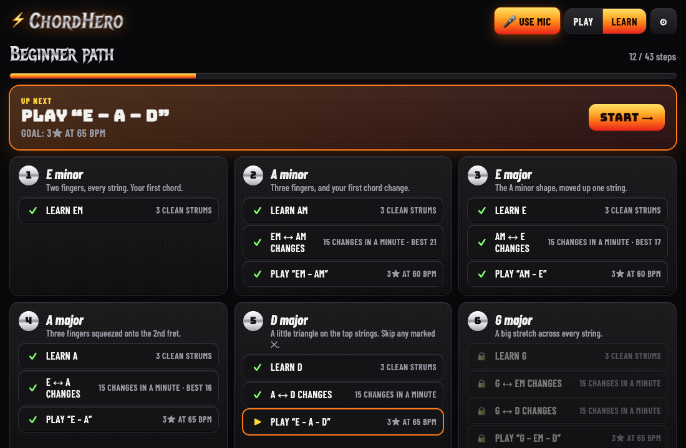
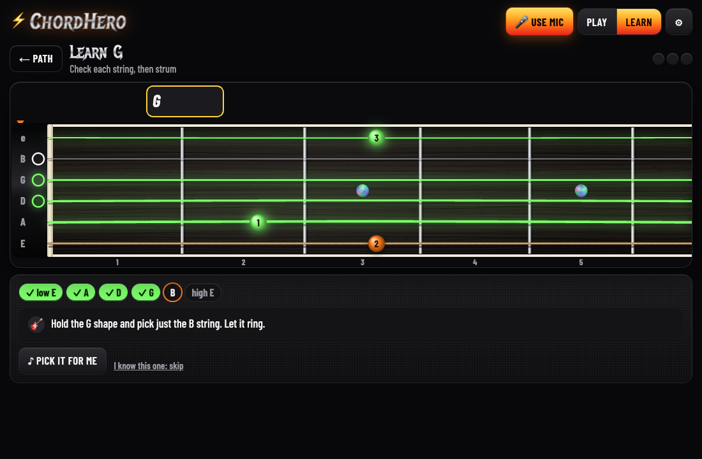
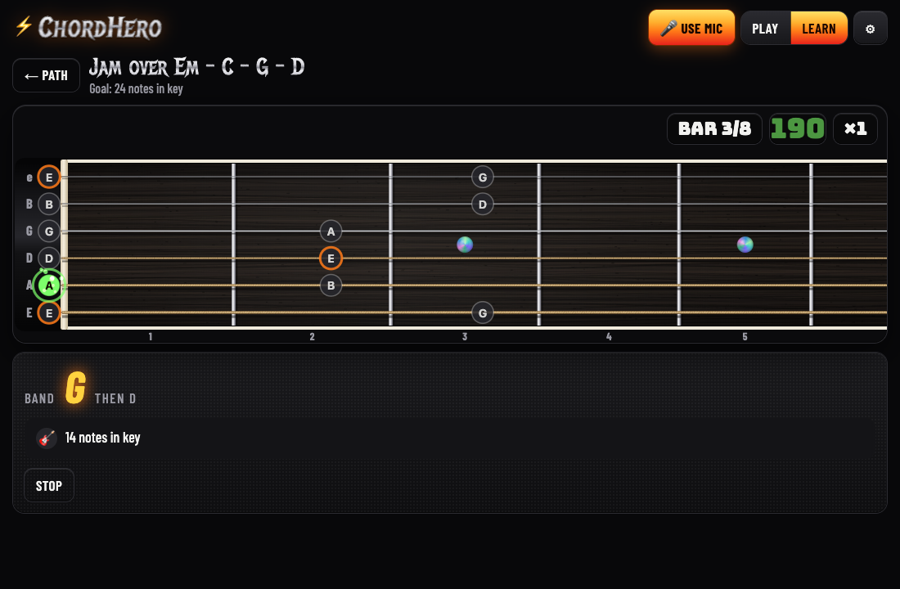

# ChordHero

**Learn guitar by playing it.** ChordHero is a chord and lead-guitar trainer that runs entirely in your browser. It listens to your real guitar through the mic, lights up each string as it hears it ring, and scores every chord Guitar Hero–style as it scrolls past. A step-by-step path teaches complete beginners 16 chords and their first scales, then puts them to work in songs and jams.

**[Play it now → kgwinnup.github.io/chordhero](https://kgwinnup.github.io/chordhero/)**. No account and no install needed. No guitar handy? Tap *Watch a demo* and the app plays itself.

<p align="center">
  
</p>

## Play

Pick a song, press **Play**, and strum along. Upcoming chords slide toward you along the top, and the neck shows exactly where your fingers go.

- **Strings that light up.** Each string of the chord glows green when the mic hears it ring. It glows bright when the whole strum sounds like the chord, and dim when it doesn't, however hard you hit it. A wrong chord shows **✕ Not Am**. Hitting a string marked ✕ makes it vibrate red and costs you points.
- **Guitar Hero–style scoring.** Every chord is graded Perfect, Great, Good, OK or Miss, on how many strings rang and how close to the beat you strummed. You also get combo multipliers, sparks, an optional crowd that cheers you on, and a results screen with your best score.
- **Songs to play.** Built-in progressions run from *Em → G* to *C – G – Am – F* and a *Blues in E*. **🎲 Random: chords you know** deals a fresh run from just the chords you've learned. You can also choose **Build your own…** to make and save your own sequences, with each chord lasting 1–8 beats.
- **Practice your way.** The settings (⚙) include *Wait for me* (the song waits on each chord until you play it), adaptive tempo, a metronome, count-in, looping and detection sensitivity. The app also works on 7-string guitars and 3-string guitars (tuned G B E).

<p align="center">
  
</p>

## Learn

The **Learn** screen holds two paths. Your progress is saved, and each step unlocks the next.

<p align="center">
  
</p>

### Beginner path: 16 chords

The path covers 12 units. It starts with two-finger E minor, then Am, E, A, D, G and C, then Dm, the seventh chords (E7, A7, D7, G7, B7), and the first barre chords: F (via Fmaj7) and Bm. Every chord goes through three stages:

1. **Learn the shape.** You first pick each string on its own, from low to high. A string only counts if its note jumps when you pick it, so a muted string can't slip through. Then you strum the chord cleanly three times. A coach tells you which string didn't ring and why, for example a finger leaning on the next string, or not pressing close enough to the fret.
2. **Drill the changes.** Switch between the new chord and one you know as many times as you can in a minute. Only clean changes count, and your best is kept.
3. **Play it in a song.** Earn enough stars on a short progression to pass.

<p align="center">
  
</p>

### Lead guitar: your first scales

E minor pentatonic and A minor pentatonic, in open position, are learned the same way:

- **Learn the scale.** The notes appear as dots on the neck, with the root notes ringed. Pick each one in turn, up and back down. The next note glows, and the ones you've played turn green.
- **Up and down, in time.** Play the scale along with the click, first one note per beat, then in eighth notes. Each note is graded on being the right note and on time. Once you pass, a **Faster** button adds 10 BPM at a time, and your best tempo is kept.
- **Jam.** A band plays a progression and you make up a solo. Every note of the scale scores, notes in a row build a multiplier, and a note outside the scale resets it.

<p align="center">
  
</p>

## How it listens

Everything runs on your device: no audio is recorded or uploaded.

- **Chords.** For each string, ChordHero checks whether that string's note stands out from the background noise. It works through the strings from low to high, so one string's overtones aren't mistaken for another string ringing. It also checks that the strum as a whole sounds more like the target chord than any other.
- **Single notes.** For scales, it compares the sound just after each pick with the sound just before it. Strings that were already ringing are in both and cancel out, so only the new note is left.
- **Timing.** Strums and picks are timed from the audio itself, to within a few milliseconds.

## Install it like an app

ChordHero is an installable web app. It gets its own icon, opens full-screen, and works offline after the first launch.

- **iPhone / iPad:** open the site in Safari, tap **Share**, then **Add to Home Screen**.
- **Android:** open it in Chrome and tap **Install app** (or menu ⋮ → **Add to Home screen**).

On a phone, ChordHero shows a tip explaining how to install it. Dismissing the tip hides it for two weeks.

## Tips for good detection

- Tune your guitar first.
- Put the phone or laptop within about 1 m of the soundhole.
- If strings won't light, slide **Detection** toward *lenient* in ⚙. If wrong chords count, slide it toward *strict*.
- For the jams, wear headphones, so the mic doesn't pick up the backing band.

## Develop

```bash
npm install
npm run dev
npm test
```

The tests feed synthetic guitar sound through the detectors. They check that a single plucked string lights only itself, that a full strum lights the whole chord, that strums are timed precisely, and that a new note is heard over strings still ringing. They also cover the scoring, the timeline, the presets and both learning paths.

The app icon is option 7 (soundhole play) of the designs in `design/icons/` (see `design/icons/options.png`). To switch, run `node scripts/icons.mjs <number>`.

## Deploy

`npm run build` writes a fully static site to `dist/`. It uses relative paths, so it works from any host or subpath.

On GitHub, set **Settings → Pages → Source** to **GitHub Actions**. After that, every push to `main` builds and publishes the site via `.github/workflows/deploy.yml`, but only if the tests pass. Mic access needs HTTPS: GitHub Pages provides it, and `localhost` also works during development.
